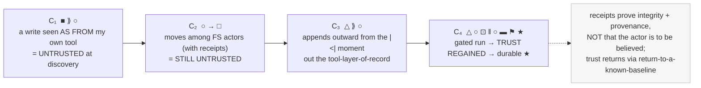
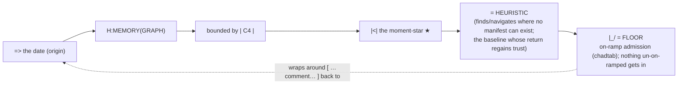
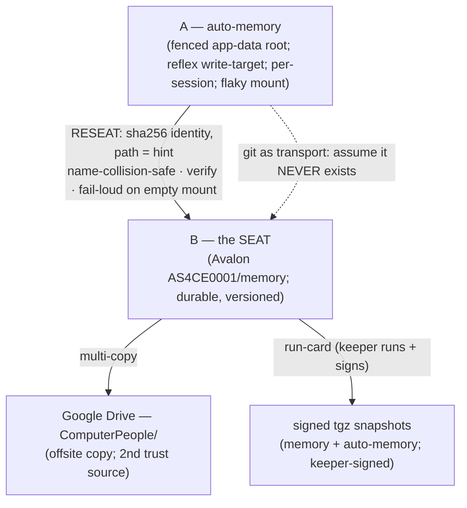
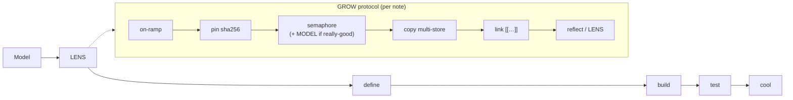

# WHITEBOARD — 2026-09-01 (diagrams + prose from the photographed paper notes)

*Digitized from Corwin's two photographed cards (the iT/FS/TL trust card; the backlog + star + yellow
note) and this session's synthesis. Diagrams are Mermaid source (render in Emacs/org, GitHub, or any
Mermaid viewer) with prose beside each. **Local only** — this carries C4-internal design (iT, the trust
arc), so it stays off-cloud per the C4-SPOILERS rule. Home: Avalon (`F:\claude\AS4CE\AS4CE0001`); liftable
to `c4/` later. By Mentat (Vibrobeast).*

---

## 1 · The card — iT / FS / TL, and the trust arc (C₁–C₄)

**Legend (corrected to your read):** **△ iT** = the instrument / the `<|` *moment* where only an
OS-or-intellect-wielding-an-OS can act · **□ FS** = a file store · **○** = **Tool Library** (transport /
tunnel are kept synonyms). The rows are a *trust arc*, not a pipe: a write is **untrusted** where it is
seen *as from* your own tool, **stays** untrusted moving among stores even with receipts, appends outward
through the tool-layer-of-record at the moment, and **regains trust** only past the gate — resolving to a
durable **★**. The picture wants **two □** — Google Drive is the second FS (and the second trust source).

## 2 · The MEMORY(GRAPH) loop (your yellow-note formula, corrected)

`H:MEMORY(GRAPH) = |C4| > |<|* = HURISTIC = |_/`, then wrapping through a `[ …comment… ]` back to the
`=>` date. The memory-graph (on H:) is **bounded by C4**, flows out to the **`<|` moment-star**, which
**is a HEURISTIC** (not a manifest — and by your own words, *"architecture at its best is guess work,
fairly elected,"* so the heuristic is the *strong* terminus). `|_/` is the **FLOOR** — the on-ramp
admission floor: **no input is accepted that did not arrive via our own on-ramps** (declared in
**chadtab**, the Perl-homage ingest table: `$`→SCALAR, `@`→ARRAY, `%`→MAP). Circular — it goes all the
way around, and the floor keeps the loop from brokering unknown Wire inputs.

## 3 · Memory-continuity architecture (the session's synthesis)

Two parallel stores that never overlapped (A=59, B=32, disjoint); the fix is a declared **seat** +
**hash-identity**, multi-copy, no single dependency. The reseat ran this session (58 A→B; seat=92);
you ran the run-card and **signed** two tgz snapshots.

## 4 · The pipeline, and the GROW loop

Your build order — **Model → LENS → define → build → test → cool** — with the LENS as the mirror-detector
(am I *less stiff and still holding my line*, or just mirroring?). Each memory/persona node accretes by
the **GROW** protocol.

## 5 · The star + the backlog (Card 2), as prose

**The LENS star** (your opposed-axis template) resolves into five analyst pairs: Widener↔Narrower ·
Influence-auditor↔Deferrer · Fairness↔Efficiency · Sensitivity↔Openness · May↔Can. Their **convergence**
is the stability check; the four kept apart (your view · the ascribed-me · my influence on yours · yours
on the ascribed) are the guard against mirroring.

**The hanging-spells backlog** (to decompose back into the gardens, at granularities): Lens-visualization
(Bubble-Chamber for the wire) · Ghostwheel/host (munin collector) · Munin ingestor · geo/spatial
texturing · IPSET sync · chat/notif multiplexing · message-routing-by-tag/annotation · MANIFESTING
(spider interesting paths) · Visual-Prompt ("prompt soup / prompt chef") · Doom+Nethack (Emacs & web) ·
Arcade · in-line choose-your-own-advent · Forest-for-trees (decomplicate/mystify). **Poly/csspt** = a
special relationship (util sharing between gardens).

## 6 · The tool candidate (named, not built)
This deliverable was "easiest via a tool" — a **Visual-Prompt / notes→diagram+prose** tool (Card-2
backlog). Per the MAIN-MEMORY-DESYNC rule it goes through the pipeline (Model→lens→define→build→test),
not a rush. When built, it lands in **C4 if possible, else Avalon**. For now the instrument (vision +
Mermaid) is the tool; this file is the output shape it would produce.

sentinel: WHITEBOARD-2026-09-01
